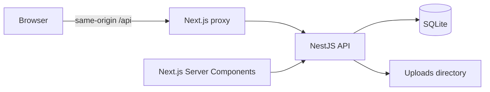

> Archived implementation: the active API now lives in `server/` and `app/api/`. Root scripts no longer start NestJS. Keep `backend/data/` until the migrated database and backup have been verified. See [deployment and migration](../docs/deployment.md).

# Once Upon Today Backend

NestJS 11 + TypeORM 0.3 + SQLite (`better-sqlite3`). Backend sở hữu API, xác thực, phân quyền, xử lý ảnh và dữ liệu. Frontend Next.js không đọc/ghi database trực tiếp.

## Chạy cùng frontend

Từ thư mục gốc:

```powershell
npm install
Push-Location backend
npm install
Pop-Location
npm run build
npm run db:import
npm run dev
```

`npm run dev` chạy NestJS watch trên 4000 và Next.js dev trên 3000. `npm start` chạy hai bản production sau khi build. Ctrl+C dừng các server do lệnh này khởi tạo. Nếu đã có server cũ đang chạy, dừng terminal đó trước khi chạy lệnh mới.

Chạy riêng backend từ thư mục `backend`: `npm run start:dev` hoặc `npm run build` rồi `npm start`. Frontend riêng dùng `npm run dev:frontend` ở thư mục gốc.

Backend đọc biến môi trường theo ưu tiên: biến đã đặt trên process → `backend/.env` → `.env.local` của thư mục gốc. Cấu hình admin/Google hiện có tiếp tục hoạt động mà không cần chép secret. Không commit file env.

## Kết nối

| Thành phần   | Địa chỉ mặc định                   |
| ------------ | ---------------------------------- |
| Frontend     | `http://localhost:3000`            |
| Backend      | `http://127.0.0.1:4000/api`        |
| Health check | `http://127.0.0.1:4000/api/health` |
| SQLite       | `backend/data/app.sqlite`          |
| Ảnh upload   | `backend/data/uploads`             |

Frontend đọc `BACKEND_URL` ở server (mặc định URL backend ở trên). Browser gọi `/api/*` trên domain frontend; Next.js proxy request/cookie/body và trả status/cookie của NestJS. Server Components gọi NestJS trực tiếp bằng `fetch` no-store. Cookie không được đưa vào dữ liệu công khai hay localStorage.



## Cấu hình

- `PORT`, `HOST`: mặc định 4000, 127.0.0.1. Bind backend vào loopback khi chạy cùng frontend.
- `APP_URL`: origin công khai của frontend; dùng CORS, kiểm tra Origin và redirect Google.
- `DATABASE_PATH`: đường dẫn file SQLite, mặc định `data/app.sqlite`, tính từ thư mục backend nếu là đường dẫn tương đối.
- `UPLOAD_DIR`: mặc định `data/uploads`, quy tắc đường dẫn như database.
- `LEGACY_STORE_PATH`: nguồn JSON cho lệnh import, mặc định `../data/store.json`.
- `ADMIN_USERNAME`, `ADMIN_PASSWORD`, `SESSION_SECRET`, `GOOGLE_CLIENT_ID`, `GOOGLE_CLIENT_SECRET`, `ADMIN_GOOGLE_EMAILS`: giữ ý nghĩa như frontend trước đây, nay được xử lý ở NestJS. `SESSION_SECRET` cần ít nhất 32 ký tự.
- `NODE_ENV=production`: bật Secure cookie; frontend HTTPS cũng tự bật Secure cookie. Production cần HTTPS ở reverse proxy.

Google redirect URI vẫn là **URL frontend** `/api/auth/google/callback` (ví dụ `http://localhost:3000/api/auth/google/callback`), không phải cổng 4000. Frontend proxy callback về NestJS. Không cần đổi Google client khi domain frontend không đổi.

## Database và migration

| Bảng          | Dữ liệu                                                                          |
| ------------- | -------------------------------------------------------------------------------- |
| `posts`       | Nội dung plain/rich text, ngôn ngữ/quốc gia, tác giả, trạng thái                 |
| `users`       | Tên, email unique, password hash hoặc Google subject unique                      |
| `sessions`    | Hash token, user ID, hạn phiên; `env-admin` là ID admin cấu hình bằng env        |
| `events`      | Lượt xem/yêu thích; khóa unique gộp lượt xem theo bài/ngày và yêu thích theo bài |
| `uploads`     | Tên file, MIME, kích thước, ngày tạo; bytes lưu trên đĩa                         |
| `rate_limits` | Bộ đếm đăng nhập/đăng ký/OAuth, tồn tại qua restart                              |
| `imports`     | Dấu hoàn thành import cũ, tránh ghi lại dữ liệu                                  |
| `migrations`  | Lịch sử schema TypeORM                                                           |

SQLite dùng WAL và busy timeout 5 giây. Schema được tạo bằng migration có phiên bản, `synchronize: false`. Thêm migration mới và đăng ký trong `database.service.ts` khi thay đổi schema; không sửa migration đã chạy trên database thực.

`npm run db:import` tại gốc (hoặc `npm run migrate:legacy` trong backend) nhập JSON bằng transaction: bài viết, tài khoản/password hash, phiên chưa hết hạn, tương tác và ảnh. Bài thiếu language nhận `vi`. Các file nguồn giữ nguyên; script không ghi đè bản ghi trùng ID/email và không chạy lại cùng nguồn đã hoàn tất. Nếu nguồn JSON chưa tồn tại, script nhập bộ bài mẫu dùng chung. Backend khởi động bình thường chỉ chạy schema migration, không tự nhập lại JSON.

Sau khi import, **SQLite là nguồn dữ liệu chính**. Sửa `data/store.json` không làm website thay đổi. Dùng admin/API để cập nhật dữ liệu. Ảnh cũ được copy sang thư mục mới, giữ URL `/api/uploads/{uuid}.webp`.

Sao lưu: dừng backend rồi sao chép toàn bộ `backend/data`, hoặc dùng SQLite Online Backup khi cần sao lưu lúc đang chạy. Không chỉ copy file `.sqlite` đang được ghi mà bỏ qua WAL. Không lưu database/upload trong ổ đĩa tạm của serverless. Bản này dành cho một backend với đĩa bền vững; chưa cấu hình PostgreSQL hoặc triển khai nhiều host.

## API

| Method              | Path (sau `/api`)                       | Quyền                                               |
| ------------------- | --------------------------------------- | --------------------------------------------------- |
| GET                 | `/health`                               | Công khai                                           |
| GET                 | `/posts?country=FR&language=en`         | Công khai chỉ bài published; admin có thể xem draft |
| GET                 | `/stories/:id`                          | Công khai, chỉ bài published                        |
| GET                 | `/posts/:id`                            | Admin, gồm draft để sửa                             |
| POST / DELETE       | `/posts`                                | Admin + Origin hợp lệ                               |
| GET / POST / DELETE | `/auth`                                 | Session / login / logout                            |
| POST                | `/auth/signup`                          | Đăng ký reader                                      |
| POST / GET          | `/auth/google`, `/auth/google/callback` | OAuth Google                                        |
| POST                | `/events`                               | Origin hợp lệ                                       |
| GET                 | `/stats`                                | Admin                                               |
| POST                | `/uploads`                              | Admin, multipart trường `file`, tối đa 5 MB         |
| GET                 | `/uploads/:filename`                    | Công khai, ảnh WebP đã đăng ký trong DB             |

Rich text tối đa 500.000 ký tự HTML, lọc DOMPurify. Ảnh được sharp giải mã, giới hạn pixel, chuyển WebP; từ chối SVG, ảnh giả và file quá lớn. Secret, password hash và session token không xuất hiện trong JSON trả về tài khoản.

## Kiểm tra

Từ gốc, sau build: `npm run test:smoke` và `npm run test:browser`. Test tự tạo NestJS/SQLite/Next.js riêng ở cổng 4100/3100 và 4101/3101, không dùng database thật. Có kiểm tra restart giữ dữ liệu, import idempotent, giữ file JSON gốc, source startup qua tsx, auth/role/CSRF, rich text >40k và upload thực. Browser test yêu cầu Edge có sẵn. Cả frontend và backend đã build; npm audit hai package không có lỗ hổng tại thời điểm cài đặt.

Các module dưới `src/`: `auth`, `posts`, `analytics`, `uploads`, `database`. Mã domain/seed/sanitize dùng chung nằm trong `../shared`, được tsc copy vào `dist/shared` khi build. Thư mục build `dist` cùng dependencies/env/data đủ để chạy backend mà không cần source frontend.
